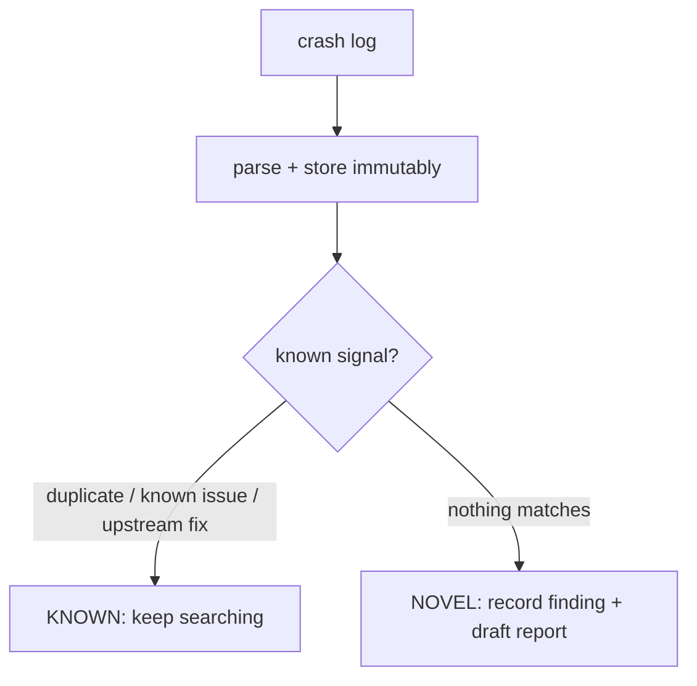

# Crash Triage and Novelty

Two commands handle crash logs. Both treat the log as **untrusted data** and
store the original immutably.

## Quick parse

```bash
system-agent crash analyze --input ./crash.log
```

Parses a KASAN/KCSAN/Oops/panic report into structure (bug class, fault site,
access, normalized stack frames, dedup signature) and stores the raw log once
under `evidence/crashes/<sha>.log` (mode `0444`).

## Novelty workflow

```bash
system-agent crash triage --input ./crash.log --source /path/to/linux
```

`crash triage` (in `core/triage_flow.py`) judges whether the crash is
already-known, using three signals:

1. **Local crash index** — has this signature been seen before? (duplicate)
2. **Known-issue registry** — does it match a recorded known/fixed bug?
3. **Patch correlation** — does the local kernel git history contain an upstream
   commit that appears to fix the fault area? (a 1-day indicator)



- **Known** → verdict recommends continuing the search for a different crash.
- **Novel** → records a candidate finding (a *hypothesis*) and drafts a report
  at `reports/<finding_id>.md`.

## The known-issue registry

Populate it from official info (online) or by hand:

```bash
system-agent setup known-issues    # online: surface kernelCTF known/fixed bugs + patches
system-agent crash known list
system-agent crash known add --signature crash:3bb7d2a5 --fix-commit <sha> --note "already submitted"
```

Entries match by exact signature or by fault symbol. "Fetching patch info and
kernelCTF info" is a Phase-A (online) action that feeds this registry; the
offline triage then uses it without any network access.
